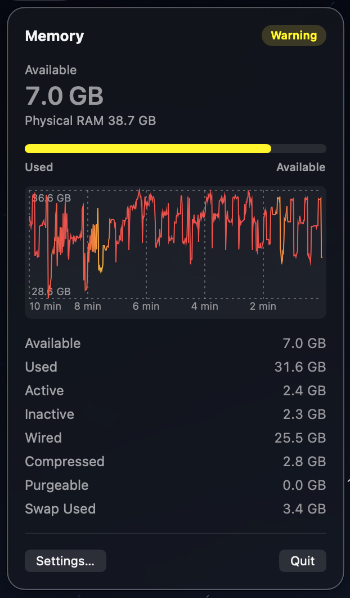

# RAM Control

> [Русская версия](README.ru.md)



RAM Control 1.3 is a macOS menu bar utility. It shows how much memory is still available and, on click, opens a panel with the details. There is no Dock window: the app lives as a menu bar agent.

It needs macOS 14 or later and a Mac with Apple Silicon.

Download: [RAM-Control-1.3.dmg](RAM-Control-1.3.dmg)

## Menu bar

The menu shows only available memory, with one digit after the decimal point: `18.4 GB` or `18.4 GiB`. If memory cannot be read, or the total is zero, the label is an em dash instead of a number.

The menu label keeps the normal menu text color. The tooltip shows the state: Normal, Warning, Critical, or No data.

## Panel

A click on the label opens the panel.

- The title Memory and a state badge. The badge uses the same color as the bar.
- Available memory in large type. That figure, and every value from Available through Swap Used, stays gray (`NSColor.systemGray`).
- A Physical RAM row: the full amount the system reports.
- A usage bar for the Used share. Used is labeled on the left, Available on the right. The bar uses the state palette. With no data it uses the accent color.
- A chart, when it is enabled in Settings. Time runs left to right: the right edge is now, and history fills in toward the left. Height is occupied bytes, scaled from the minimum to the maximum of the visible samples. The line is 1 pt thick and has no fill. Each sample stores its color when it is read, and that color stays put after the thresholds change. Neighboring stored colors still blend. A gap longer than 20 seconds breaks the line. A gray dashed grid draws five vertical lines at `window/5 … window`, each labeled with its duration, and two horizontal lines for the minimum and maximum occupied memory. The window is 1, 3, 5, or 10 minutes. The default is 5.
- The rows Available, Used, Active, Inactive, Wired, Compressed, Purgeable, and Swap Used.
- Settings… and Quit.

The panel has no Updated row. The list refreshes on its own at the chosen interval.

### What the rows mean

**Available** is how much physical RAM can still be taken. It is the Activity Monitor figure, not a sum of free pages from older reports.

**Used** is the memory RAM Control treats as occupied. It is always total minus available, and it never exceeds the total.

Occupied memory follows App Memory, Wired Memory, and Compressed in Activity Monitor:

- app memory is anonymous pages with purgeable pages removed;
- wired memory is pages the system cannot page out;
- compressed memory is the space the compressor occupies in RAM now, not the size of the data before compression.

Those three amounts are added together and cannot exceed the total. Active, Inactive, Purgeable, and Swap stay out of that sum. They are separate rows, so the breakdown stays visible.

**Active** — pages touched recently.

**Inactive** — pages that are still in RAM and have not been touched for a while.

**Wired** — kernel and driver memory that cannot be compressed or given back.

**Compressed** — how much space compressed pages occupy in RAM.

**Purgeable** — memory the system may release without writing it to disk. Those pages are already inside other counters, so they are not added to Available again.

**Swap Used** — bytes currently stored in swap. It is not the compressor page count.

The rows do not have to add up to the total. The same pages belong to more than one counter, and the file cache is outside Used.

### Colors

Thresholds compare available memory with the total. The boundary stays in the stricter state: exactly 30% with a warning threshold of 30 is Warning.

Numbers on the panel are gray. Color belongs to the bar and the badge:

| State | When | Bar and badge |
|---|---|---|
| Normal | available is above the warning threshold | gray |
| Warning | available is above the critical threshold, and at or below the warning threshold | yellow |
| Critical | available is at the critical threshold or below | red |
| No data | the read failed, the total is zero, or the thresholds are invalid | badge in the primary text color, bar in the accent color |

The chart uses the same red, yellow, and gray scale. Each point keeps the color recorded with the sample.

The default warning threshold is 30% free, and the default critical threshold is 15%.

## Settings

Settings… on the panel opens the window and brings it to the front.

Reset Settings sits in the top-right corner of the content. There is no caption under the button.

### General

**Launch at login.** RAM Control opens with the macOS account. The switch reads and writes only the system login item. An item that is already enabled is left alone.

Launch at login works for a copy in Applications. macOS usually rejects a copy started from the build directory. The error text stays in Settings, and the app keeps running. When the system asks for approval, enable RAM Control in System Settings → General → Login Items & Extensions.

**Refresh interval.** How often memory is read: 0.2 seconds, 0.5 seconds, 1 second, 2, 5, or 10 seconds. The default is 1 second. Changing the interval stops the previous cycle and starts one new cycle. After the Mac wakes, one extra sample is taken. Sleep does not start a second timer.

A shorter interval redraws the chart more often. The memory formula stays the same.

### Appearance

**Language.** English or Русский. English is the default. The names in the picker are always `English` and `Русский`. The units `GB` and `GiB` stay as written.

**Units.** `GB` is decimal gigabytes, divisor 1,000,000,000. `GiB` is binary gibibytes, divisor 1,073,741,824. Both show exactly one digit after a decimal point. The default is GB.

**Memory graph.** Shows or hides the chart on the panel. Samples keep accumulating while the chart is hidden, so turning it on shows the recent history. History lives only in the current launch and is not stored in settings. At most 10 minutes are kept.

**Graph period.** 1, 3, 5, or 10 minutes. The default is 5 minutes. The control stays disabled while the chart is off. The period chooses which part of the collected history is drawn.

### Memory thresholds

Two integers from 1 to 99. Critical must be strictly lower than Warning.

An invalid pair leaves the saved thresholds in place, and the bar does not pick a state from the draft values. A number below 1 or above 99 is brought back into range. If critical is then not lower than warning, the pair is rejected and the fields return to the last saved values.

### About

Two lines, and nothing else:

```text
Version: RAM Control version 1.3
Author: Голицын Артем (2026)
```

In Russian the same lines are `Версия: RAM Control версия 1.3` and `Автор: Голицын Артем (2026)`. The version number comes from the built app. The author name is not translated.

### Reset

Reset Settings returns the interval to 1 second, turns the chart on, sets the chart period to 5 minutes, the units to GB, the language to English, and the thresholds to 30 and 15. Launch at login stays as it is. The in-memory chart history is kept.

## Installation

Open [RAM-Control-1.3.dmg](RAM-Control-1.3.dmg) and drag RAM Control into the Applications folder.

If macOS will not open the app, clear quarantine or confirm the launch in Finder (right-click RAM Control, then Open):

```bash
xattr -dr com.apple.quarantine "/Applications/RAM Control.app"
```

### Build from source

```bash
./build.sh
```

The script builds a Release for Apple Silicon and signs the app locally. It prints the path to `RAM Control.app`.

Copy that app into Applications:

```bash
cp -R "/absolute/path/RAM Control.app" /Applications/
```

## Limits

- Apple Silicon only, and macOS 14 or later.
- The app uses no network. Memory is read with Mach and `sysctl`, not by launching `vm_stat`, `top`, or `memory_pressure`.
- A failed read clears the panel. The previous sample is not left on screen as if it were new.
- Launch at login needs an installed copy, usually in `/Applications`.
- `strerror` and `mach_error_string` stay in the system language. Only the sentence around them is translated.

## License

[MIT](LICENSE)
