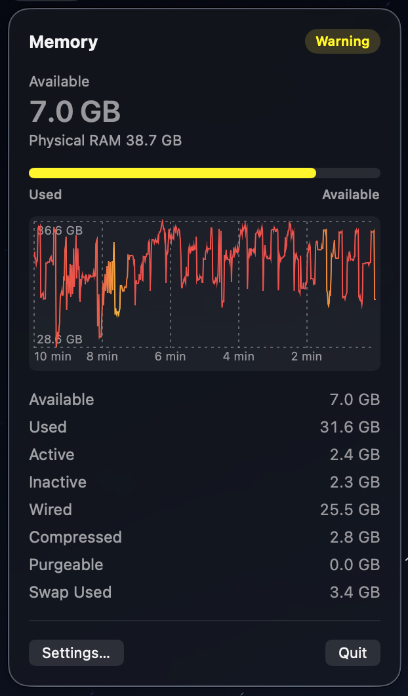

# RAM Control

> [English](README.md)



RAM Control 1.4 — программа в строке меню macOS. Она всё время показывает, сколько оперативной памяти ещё свободно, и по клику открывает панель с подробностями. Окна в Dock нет: приложение живёт как агент меню-бара.

Нужны macOS 14 или новее и Mac на Apple Silicon.

Скачать: [RAM-Control-1.4.dmg](RAM-Control-1.4.dmg)

## Строка меню

В меню видна только доступная память, один знак после точки: `18.4 GB` или `18.4 GiB`. Если прочитать память не удалось или общий объём равен нулю, вместо числа стоит «—».

Надпись в меню остаётся обычного цвета. Наведите курсор — появится состояние: Normal, Warning, Critical или «Нет данных».

## Панель

Клик по надписи открывает панель.

- Заголовок «Память» и бейдж состояния. Цвет бейджа совпадает с цветом полосы.
- Крупно — сколько памяти доступно. Это число и числа в нижнем списке всегда серые.
- Строка физической RAM: полный объём, который видит система.
- Полоса занятости. Слева — занято, справа — доступно. Длина закрашенной части — доля занятой памяти. Цвет полосы и бейджа один и тот же: серый, когда свободно больше порога предупреждения, жёлтый между порогами, красный на критичном пороге и ниже. Пока данных нет, полоса рисуется цветом акцента.
- Под полосой подписи «Занято» и «Доступно».
- График, если он включён в настройках. Время идёт горизонтально: правый край — сейчас, история заполняется влево. Высота — занятые байты, шкала от минимума до максимума видимых замеров. Линия толщиной 1 пиксель, без заливки. Цвет точки записывается в момент замера и больше не меняется, даже если потом сдвинуть пороги. Соседние записанные цвета по-прежнему переходят плавно. Пауза дольше 20 секунд разрывает линию. Серым пунктиром отмечены пять равных промежутков выбранного периода, с подписью длительности, и две горизонтальные линии: минимум и максимум. Окно 1, 3, 5 или 10 минут, по умолчанию 5.
- Нижний список зависит от настройки «Показывать». «Тяжелые процессы» — режим по умолчанию: до восьми процессов, которые сейчас занимают больше всего памяти, и сколько памяти у каждого. «Статистика» — прежний список: Доступно, Занято, Активная, Неактивная, Закреплённая, Сжатая, Очищаемая, Подкачка.
- Кнопки «Настройки…» и «Завершить».

Строки «Обновлено» на панели нет. Список обновляется сам, с выбранным интервалом.

### Что означают строки

Эти строки видны, когда в «Показывать» выбрана «Статистика».

**Доступно** — сколько физической RAM ещё можно занять. Это не сумма «свободных» страниц из старых отчётов.

**Занято** — память, которую RAM Control считает занятой. Всегда равно «всего минус доступно» и никогда не больше общего объёма.

Занятая память считается так же, как App Memory, Wired и Compressed в Activity Monitor:

- память приложений — анонимные страницы без очищаемых;
- закреплённая — страницы, которые система не может выгрузить;
- сжатая — сколько места компрессор занимает в RAM сейчас, а не размер данных до сжатия.

Эти три величины складываются и не могут превысить общий объём. Активная, неактивная, очищаемая и подкачка в эту сумму не входят: они показаны отдельно, чтобы было видно, из чего состоит картина.

**Активная** — страницы, к которым недавно обращались.

**Неактивная** — страницы, которые пока лежат в RAM, но их давно не трогали.

**Закреплённая** — память ядра и драйверов, которую нельзя сжать или отдать.

**Сжатая** — объём, который сжатые страницы занимают в оперативной памяти.

**Очищаемая** — память, которую система имеет право освободить без записи на диск. Она уже учтена внутри других счётчиков, поэтому к «доступно» отдельно не прибавляется.

**Подкачка** — сколько байт сейчас лежит в swap. Это не число страниц компрессора.

Категории в списке не обязаны в сумме давать общий объём: одни и те же страницы входят в несколько счётчиков, а файловый кэш в «занято» не входит.

### Цвета

Пороги сравнивают доступную память с общим объёмом. Граница не считается более спокойным состоянием: ровно 30% при пороге предупреждения 30% — это уже внимание, не норма.

Числа на панели серые. Цвет есть у полосы и у бейджа:

| Состояние | Когда | Цвет полосы и бейджа |
|---|---|---|
| Норма | доступно больше порога предупреждения | серый |
| Внимание | доступно больше критичного порога, но не больше порога предупреждения | жёлтый |
| Критично | доступно на критичном пороге или ниже | красный |
| Нет данных | чтение не удалось, общий объём равен нулю или пороги неверные | бейдж обычным цветом, полоса — цветом акцента |

На графике та же шкала красный → жёлтый → серый, но цвет каждой точки фиксируется в момент замера.

По умолчанию предупреждение — 30% свободной памяти, критично — 15%.

## Настройки

Открываются кнопкой «Настройки…» на панели. Окно появляется поверх остальных окон.

Кнопка «Сбросить настройки» стоит в правом верхнем углу. Под ней нет поясняющей подписи.

### Основные

**Запуск при входе.** RAM Control открывается вместе с вашей учётной записью macOS. Переключатель читает и меняет только системный статус login item. Повторно включать уже включённый автозапуск программа не пытается.

Автозапуск обычно срабатывает у копии в папке «Программы». Запуск прямо из каталога сборки macOS часто отклоняет — текст ошибки остаётся в настройках, программа при этом не закрывается. Если система просит разрешение, включите RAM Control в «Системные настройки → Основные → Объекты входа и расширения».

**Интервал обновления.** Как часто читается память: 0.2 секунды, 0.5 секунды, 1 секунда, 2, 5 или 10 секунд. По умолчанию 1 секунда. Смена интервала останавливает прежний цикл и запускает один новый. После пробуждения Mac делается один внеочередной замер, отдельный таймер для сна не заводится.

Короткий интервал обновляет график чаще. На формулу памяти он не влияет.

### Оформление

**Показывать.** «Тяжелые процессы» или «Статистика». По умолчанию — тяжелые процессы. Тогда вместо строк от «Доступно» до «Подкачка» панель называет восемь процессов, которые сейчас занимают больше всего памяти, и сколько памяти у каждого. Число — физический объём, как столбец «Память» в Мониторинге системы. Если таких процессов меньше восьми, список короче. Если прочитать их не удалось, строка говорит «Нет процессов» и показывает «—». «Статистика» возвращает прежний список. Крупная цифра доступной памяти, полоса и график остаются в обоих режимах.

**Язык.** English или Русский. По умолчанию английский. Названия языков в списке всегда пишутся как `English` и `Русский`. Единицы `GB` и `GiB` не переводятся.

**Единицы.** `GB` — десятичные гигабайты, делитель 1 000 000 000. `GiB` — двоичные гибибайты, делитель 1 073 741 824. В обоих случаях ровно один знак после точки и точка, не запятая. По умолчанию GB.

**График памяти.** Показывает или прячет график на панели. Пока график выключен, замеры всё равно копятся, поэтому после включения видна недавняя история. История живёт только в текущем запуске и не записывается в настройки. Хранится не больше 10 минут.

**Период графика.** 1, 3, 5 или 10 минут. По умолчанию 5 минут. Список недоступен, пока график выключен. Период только выбирает, какая часть уже собранной истории рисуется.

### Пороги памяти

Два целых числа от 1 до 99. Критичный порог должен быть строго меньше предупреждения.

Пока пара неверная, старые пороги остаются в силе и полоса не выбирает состояние «на глаз». Число меньше 1 или больше 99 приводится к границе диапазона. Если после этого критичный порог не меньше предупреждения, пара отклоняется и поля возвращаются к последним сохранённым значениям.

### О программе

Две строки:

```text
Версия: RAM Control версия 1.4
Автор: Голицын Артем (2026)
```

На английском то же самое: `Version: RAM Control version 1.4` и `Author: Голицын Артем (2026)`. Номер версии берётся из собранной программы. Имя автора не переводится.

### Сброс

«Сбросить настройки» возвращает интервал к 1 секунде, включает график, ставит период графика на 5 минут, единицы на GB, язык на английский, пороги на 30 / 15 и «Показывать» на «Тяжелые процессы». Автозапуск не меняется. История графика в памяти сохраняется.

## Установка

Откройте [RAM-Control-1.4.dmg](RAM-Control-1.4.dmg) и перетащите RAM Control в папку «Программы».

Если macOS не даёт открыть программу, снимите карантин или подтвердите запуск вручную. В Finder: правый клик по RAM Control → «Открыть».

```bash
xattr -dr com.apple.quarantine "/Applications/RAM Control.app"
```

### Сборка из исходников

```bash
./build.sh
```

Скрипт собирает Release для Apple Silicon и подписывает программу локально. В конце печатает путь к `RAM Control.app`.

Скопируйте программу в «Программы»:

```bash
cp -R "/абсолютный/путь/RAM Control.app" /Applications/
```

## Ограничения

- Только Apple Silicon и macOS 14 или новее.
- Программа не использует сеть и читает память через Mach и `sysctl`, без запуска `vm_stat`, `top` или `memory_pressure`. Список процессов читается через libproc, без `ps` и `top`.
- Если системный вызов завершился ошибкой, на панели не остаётся предыдущее число как будто оно только что обновлено.
- Автозапуск через системный login item требует установленную копию, обычно в `/Applications`.
- Системные тексты `strerror` и `mach_error_string` остаются на языке системы. Переводится только фраза вокруг них.

## Лицензия

[MIT](LICENSE)
